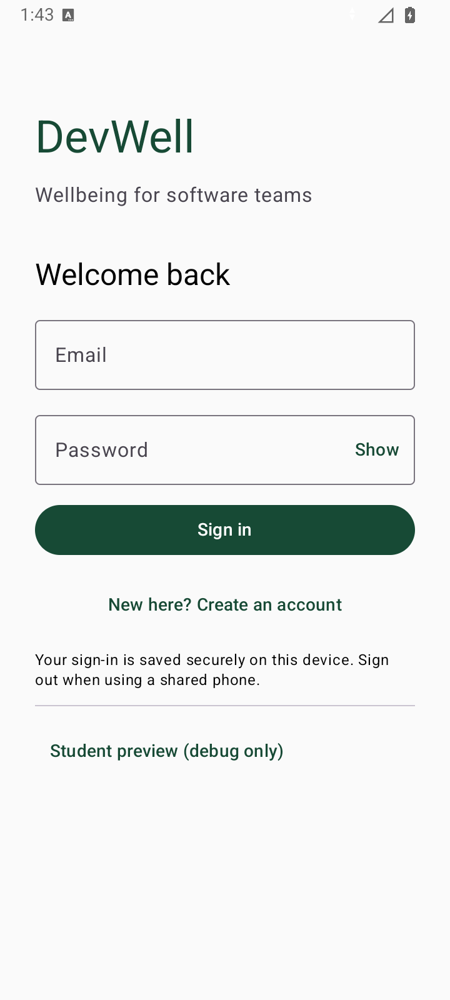

# DevWell Android

ITDMA3-34, Team 3. Native Android app using Kotlin and Jetpack Compose.

## Open and run

1. Open this folder in Android Studio (it contains `settings.gradle.kts`).
2. Under **Settings > Build, Execution, Deployment > Build Tools > Gradle**, use
   Android Studio's bundled JDK (or JDK 17), and install Android SDK 35.
   This computer's system `JAVA_HOME` points to Java 8, so do not select it.
3. Keep your local `sdk.dir` entry in `local.properties`. Add the two entries from
   `local.properties.example`, using the project's public publishable key.
4. Sync Gradle, select the shared `app` run configuration, and run it on an API 26+
   emulator or phone. The configuration builds the debug app and launches its main activity.

Never put a Supabase service-role/secret key in this app. `local.properties` is ignored.
Kotlin 2.1.0, Supabase Kotlin 3.0.3 and Ktor 3.0.2 are pinned together.
The Gradle wrapper uses 8.14.3; Android Gradle Plugin remains 8.7.3.

## Member 1

- Email/password login and engineer registration with validation and loading/error states.
- Encrypted saved sessions and sign-out, including local cleanup when offline.
- Role routing based on the backend profile, with pending/rejected access blocked.
- Company/team selection, join-request submission and approval-status refresh.
- Debug-only student preview for existing roles and the new-engineer flow.

The Member 1 database and both join-request Edge Functions are deployed. See
[supabase/README.md](supabase/README.md) for setup, API calls and verified results.
The company/team directory is intentionally empty until real names are available.
Member 6's live admin dashboard is implemented locally but its migration and function
have not been deployed. Other members' feature repositories still contain sample data;
the dashboard identifies that data as sample data.

## Team notes

- [Database and Edge Function contract](docs/member1-backend-contract.md)
- [Supabase setup and deployment notes](supabase/README.md)
- [Shareable PDF](output/pdf/DevWell-Member-1-Team-Handoff.pdf)
- [Verification record](docs/validation.md)



## Architecture

Screens call ViewModels, and ViewModels call repositories. Authentication has its own
`AuthViewModel`; the existing `DevWellViewModel` still handles the other team features.
See `data/auth` for Supabase setup, database field mapping and the identity repositories.
`model/EntryDestination.kt` holds the common role/status rules.

## Checks

Run from this folder with JDK 17:

```text
./gradlew :app:assembleDebug :app:testDebugUnitTest :app:lintDebug
./gradlew :app:connectedDebugAndroidTest
./gradlew :app:assembleRelease
```

Use `gradlew.bat` on Windows. Connected tests require a running emulator or connected
phone. Release output is unsigned; use debug for local installation. See the verification
record for actual results and the backend checks still needed.

## Team workflow

Create a feature branch, make changes in your assigned feature, run the checks, and
open a pull request for review. Coordinate shared model/repository/navigation changes.
Managers must never have access to individual check-in records; aggregate results
require at least five responses, enforced by the backend as well as the UI.
