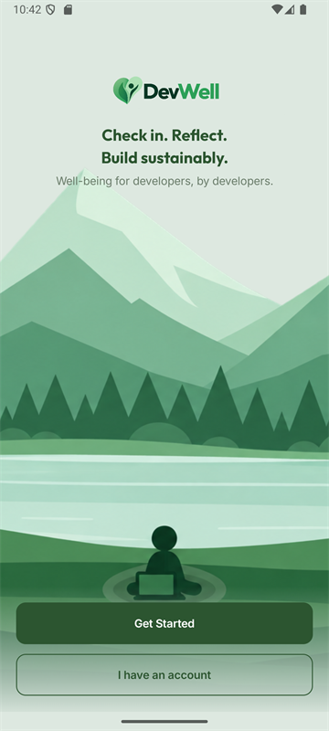

# DevWell

DevWell is a wellbeing app for software teams, built natively for Android. Engineers use
it to check in with themselves each day, spot workload and energy patterns early, and keep
their project work in one place. Managers get a useful team-level picture without ever
seeing an individual's answers.

It's a Kotlin and Jetpack Compose app backed by Supabase, with separate experiences for
engineers, managers and platform admins.



## Demo video

A narrated walkthrough of the app, covering the engineer, manager and administrator features (about 14 minutes): [Watch the demo video](docs/demo/DevWell_Demo.mp4)

## Demo accounts

You can sign in with these existing test accounts:

| Role | Email | Password |
| --- | --- | --- |
| Engineer | `test.engineer1@devwell.example` | `12345` |
| Manager | `test.manager@devwell.example` | `87654321` |
| Admin | `dan@gmail.com` | `12345678` |

These are shared review accounts, so avoid adding personal data to them.

## What's in the app

### Accounts and onboarding

- Email/password sign-up and sign-in with validation, loading states and readable error
  messages.
- New accounts choose Engineer or Manager at signup. The choice is a request; the backend
  decides the final role and never grants admin from a signup.
- Engineers pick a company and team, then wait for that team's manager to approve them.
  The waiting screen shows the request, its status and a "Check approval status" action.
- A rejected engineer can choose another company and team without losing the earlier
  request history.
- Managers create their company and first team during a short two-step onboarding.
- Sessions are encrypted on the device and restored at launch. Sign-out cleans up local
  data, including when the phone is offline.
- Pending, rejected and suspended accounts are kept out of the protected parts of the app.

### For engineers

- **Home** — greeting, a daily check-in card, a small focus prompt, quick links to trends,
  insights and the team overview, plus a short privacy reminder.
- **Daily check-in** — five steps covering wellbeing (1–5), workload (1–5), energy and
  focus (1–10 each), and after-hours work. One check-in is saved per day; opening it again
  lets you update today's answers. It takes about two minutes.
- **Offline check-ins** — if the phone loses its connection, the check-in is kept in a
  local queue and uploaded automatically once the network returns.
- **My trends** — wellbeing, workload, energy and focus averages for this week, last week,
  this month or the last three months, with a wellbeing line chart, energy/focus bar chart
  and full check-in history.
- **Insights** — plain-language observations from recent check-ins, including things worth
  watching (after-hours work, heavy workload, low energy) and practical suggested actions.
- **Team overview** — anonymised team averages, participant count and a few team
  highlights. It stays hidden until enough people have checked in.
- **What my manager sees** — a read-only preview of the exact manager dashboard, built from
  the same team aggregate and the same composable, so the preview can't drift from reality.
- **Projects & tasks** — create, edit and delete projects with a colour, description and
  deadline. Tasks have a priority, deadline, optional note and done/open status. Project
  progress is recalculated automatically, overdue items are flagged, and the list can be
  filtered by open or done.
- **Smart tips** — up to three short, rule-based suggestions generated from your tasks:
  overdue work, deadlines within two days, high-priority items and projects below 50%.
- **AI assistant** — a chat for general guidance on workload, focus and wellbeing. It asks
  for explicit consent before sending anything to Google Gemini, keeps the conversation in
  memory only, and shows a retry action if a reply fails. Requests are rate-limited.
- **Resources** — a set of evidence-backed wellbeing tips and six short desk exercises
  with step-by-step guides.
- **Notifications** — a daily check-in reminder plus preferences for check-in reminders,
  team alerts, tip nudges and quiet hours (including ranges that cross midnight).
- **Profile and settings** — profile photo, display name, password change, reminder
  settings, privacy information, help/FAQ, privacy policy, terms of service and sign-out.

### For managers

- **Overview** — an anonymised wellbeing score for the selected team, average workload and
  after-hours work, participant count, a simple bar chart and an alert note when the team
  average drops below the manager's threshold.
- **Team Data** — switch between the teams you own, create another team in your company,
  and see the same anonymised team figures.
- **Join requests** — approve or decline engineers waiting to join your team, with clear
  status chips, progress feedback and an empty state when there's nothing to review.
- **Team Insights** — workload, after-hours and focus observations with suggested actions
  for the next team conversation.
- **Team settings** — rename a team, set the low-wellbeing alert threshold, view the member
  roster (names only), remove a member, or delete the whole team. Removed and deleted-team
  members must choose a company and team again before using the app; their past check-ins
  remain private.
- **Multiple teams** — a manager can own several teams within their company and switch
  between them; the dashboard, roster and settings follow the selected team.

### For admins

- A platform overview with account counts and a user list showing each person's name,
  email, role and status.
- Suspend or reactivate non-admin accounts. Admin access cannot be changed from the screen.
- No individual check-ins, scores, notes or personal trends are exposed to admins.

## Privacy is the point

The privacy rule is shared by the app and the backend, not just hidden in the UI:

- Your individual responses and private check-in data are visible only to you.
- Managers see team aggregates only, and only after **five distinct participants** have
  checked in. Below that, they see the participant count and nothing else.
- Managers never get names attached to wellbeing data, individual scores, notes or personal
  trends. The team roster shows names only.
- Admin accounts manage access, not wellbeing content.
- The in-app privacy policy, terms and FAQ spell all of this out in plain language.

## Under the hood

- **UI:** Kotlin, Jetpack Compose, Material 3, Navigation Compose and a custom green theme
  with Outfit/Inter typography.
- **Architecture:** MVVM. Screens call ViewModels, ViewModels call repositories, and the
  repositories talk to Supabase. Shared role/status routing lives in
  `model/EntryDestination.kt`.
- **Backend:** Supabase Auth, Postgres with row-level security, Storage for avatars, and
  Edge Functions for join requests, company/team creation, team aggregates, the AI
  assistant and admin access.
- **Offline and background work:** Room for queued check-ins, WorkManager for sync and
  reminders.
- **Build:** compileSdk/targetSdk 35, minSdk 26, Kotlin 2.1.0, Android Gradle Plugin 8.7.3,
  Gradle wrapper 8.14.3, Supabase Kotlin 3.0.3 and Ktor 3.0.2.

The Supabase side includes `submit-join-request`, `review-join-request`, `create-company`,
`create-team`, `team-aggregate`, `ai-assistant` and `admin-dashboard`, along with database
RPCs for removing members, deleting teams and restarting onboarding after a rejection.
The service-role key stays on the server; the Android app only ever holds the public key.

## Running it locally

1. Open the repository root in Android Studio. It contains `settings.gradle.kts`.
2. Use Android Studio's bundled JDK or JDK 17 and install Android SDK 35. If your system
   `JAVA_HOME` points at Java 8, don't select it.
3. Keep your local `sdk.dir` in `local.properties` and add the two entries from
   `local.properties.example`: `SUPABASE_URL` and `SUPABASE_ANON_KEY` (the public
   publishable key).
4. Sync Gradle, choose the shared `app` run configuration, and run it on an API 26+
   emulator or phone.

Never put a Supabase service-role or secret key in the app. `local.properties` is ignored
by Git.

For backend setup, migrations and deployment notes, see [supabase/README.md](supabase/README.md).

## Checks

Run these from the project root with JDK 17:

```text
./gradlew :app:assembleDebug :app:testDebugUnitTest :app:lintDebug
./gradlew :app:connectedDebugAndroidTest
./gradlew :app:assembleRelease
```

Use `gradlew.bat` on Windows. Connected tests need a running emulator or connected phone.
The release APK is unsigned; use the debug build for local installation.

## Project notes

DevWell was built for ITDMA3-34 by Team 3. The database, identity flows, manager
onboarding and team aggregate function are deployed, and the debug app has been exercised
against the live project and an emulator. Some areas are still evolving, so check the
verification record before treating any single feature as production-ready.

- [Database and Edge Function contract](docs/member1-backend-contract.md)
- [Supabase setup and deployment notes](supabase/README.md)
- [Verification record](docs/validation.md)
- [Auth UI notes](docs/auth-ui.md)
